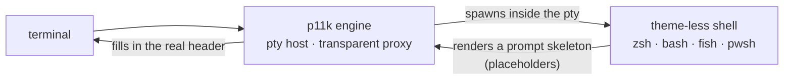

 
 

    

 
 

 

### I build my own Linux from scratch, and I write tools what I needed.

Most of that work lives one layer below the desktop: the shell prompt, the compositor, the desktop shell, and the configuration that makes a machine reproducible. Rust first; C++ when the layer underneath calls for it; Nix when the machine has to come back identical. Whenever technically feasible, I prefer to contribute upstream rather than reinvent the wheel. Some of that work is built with friends: [tuack-ng](https://github.com/tuack-ng) is our OI/ICPC problem-setting toolchain, whose GUI I wrote and maintain.

## Own work

**[powerlevel11k](https://github.com/Qaaxaap/powerlevel11k)** — a prompt engine that continues powerlevel10k, in Rust. Deliberately *not* a shell theme: the engine owns a pty, proxies bytes untouched, and fills the header in itself, so one theme runs on zsh, bash, fish and pwsh. 80+ built-in segments mirroring p10k's, a KDL v2 theme language, three icon tiers (nerdfont / compatible / ascii), and git status resolved off the prompt thread.

The engine never parses ANSI out of the pty stream and never touches user input.
The input line stays the shell's own line editor, so completion, history and vi
mode keep their geometry.

The other project I keep up with is [**Tuack-GUI**](https://github.com/tuack-ng/Tuack-GUI): the GUI front-end for tuack-ng's problem-setting workflow, written and maintained by me in that org.

| Repository | What it is | Stack |
| :--- | :--- | :--- |
| [**powerlevel11k**](https://github.com/Qaaxaap/powerlevel11k)  | p10k's successor: pty host + transparent proxy, multi-line header, transient prompt |  |
| [**Tuack-GUI**](https://github.com/tuackng/Tuack-GUI)  | GUI front-end for OI/ICPC problem setting on top of tuack-ng: project tree, `conf.json` forms, command buttons — written and maintained by me |  |
| [**nix-workspace**](https://github.com/Qaaxaap/nix-workspace) | Home Manager flake workspace, reproducible end to end, and readable as a Nix entry point |  |
| [**NixOS-dots**](https://github.com/Qaaxaap/NixOS-dots) | My NixOS configuration |  |
| [**klipper-dots**](https://github.com/Qaaxaap/klipper-dots) | Klipper configuration for a Voron Trident |  |
| [**qaaxaap-blog**](https://github.com/Qaaxaap/qaaxaap-blog) | The Hexo site behind [blog.qaaxaap.living](https://blog.qaaxaap.living) |  |

## Upstream

Patches I've sent upstream:

| Upstream | What I contributed |
| :--- | :--- |
| [**noctalia**](https://github.com/noctalia-dev/noctalia) noctalia-dev | Wayland desktop shell — bar font scale, PipeWire in-follow passive mode, control-center clock and tab handling, settings writes made idempotent · **5 merged** |
| [**umbriel**](https://github.com/noctalia-dev/umbriel) noctalia-dev | scrolling/dwindle Wayland compositor — resize from a named edge, modifier-only binds surviving an active input method, overview progress clamping · **3 merged, 4 open** |

## Toolbox

Linux From Scratch #32117 · Voron v0.4408 · Nix on the side

