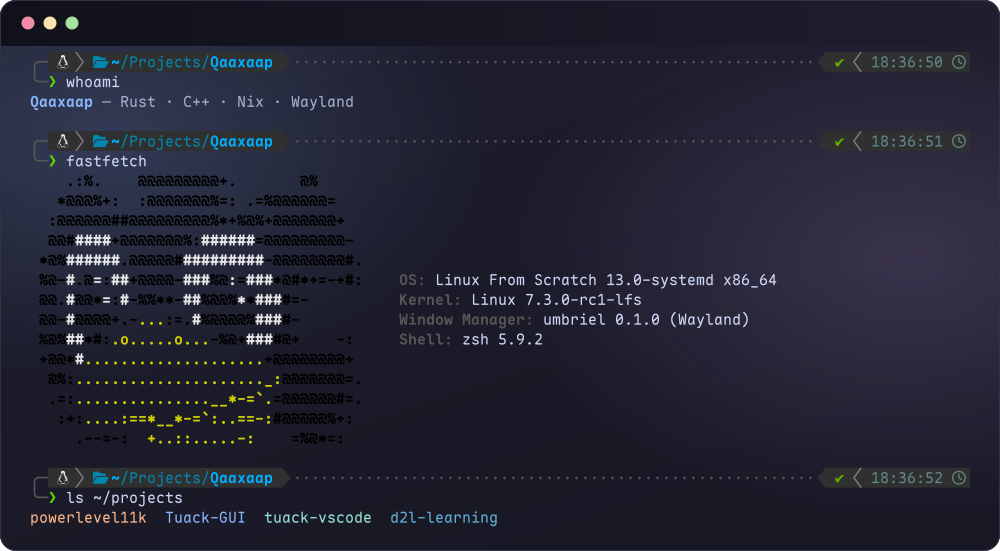
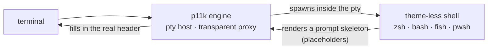

 
 

    

 
 

 

Rust and C++ for the layer below the desktop: shell prompts, Wayland compositors, package tooling, and the Nix and LFS setups around them. I also work on [tuackng](https://github.com/tuackng), an OI/ICPC problem-setting toolchain, with friends.

## Projects

**[powerlevel11k](https://github.com/Qaaxaap/powerlevel11k)** is a prompt engine that continues powerlevel10k, written in Rust. It is not a shell theme: the engine owns a pty, proxies bytes untouched, and fills the header in itself. One theme therefore runs on zsh, bash, fish and pwsh. More than 80 built-in segments match p10k's, and the theme uses the KDL v2 language. Three icon tiers are available: nerdfont, compatible and ascii. Git status runs on a background thread.

The engine does not parse ANSI out of the pty stream and does not touch user input. The input line stays the shell's own line editor, so completion, history and vi mode keep their geometry.

I also wrote two front-ends for tuack-ng: [**Tuack-GUI**](https://github.com/tuackng/Tuack-GUI) for problem setting, and [**tuack-vscode**](https://github.com/Qaaxaap/tuack-vscode), an extension for VS Code and VSCodium that drives tuack-ng over JSON-RPC.

| Repository | What it is | Stack |
| :--- | :--- | :--- |
| [**powerlevel11k**](https://github.com/Qaaxaap/powerlevel11k)  | Prompt engine after p10k: pty host, transparent proxy, multi-line header |  |
| [**Tuack-GUI**](https://github.com/tuackng/Tuack-GUI)  | Cross-platform GUI for setting OI/ICPC problems on tuack-ng: project tree, `conf.json` forms, command buttons |  |
| [**tuack-vscode**](https://github.com/Qaaxaap/tuack-vscode)  | VS Code and VSCodium front-end for tuack-ng, driven by `tuack-ng-rpc` |  |
| [**d2l-learning**](https://github.com/Qaaxaap/d2l-learning)  | Study log for Dive into Deep Learning: notes, exercises and self-check assertions |  |
| [**nix-workspace**](https://github.com/Qaaxaap/nix-workspace) · [**NixOS-dots**](https://github.com/Qaaxaap/NixOS-dots) · [**vscode-dots**](https://github.com/Qaaxaap/vscode-dots) · [**klipper-dots**](https://github.com/Qaaxaap/klipper-dots) | Configuration kept in git: packages, the machine, the editor, the printer |   |
| [**qaaxaap-blog**](https://github.com/Qaaxaap/qaaxaap-blog) | The Hexo site behind [blog.qaaxaap.living](https://blog.qaaxaap.living) |  |

## Upstream patches

| Upstream | What I contributed |
| :--- | :--- |
| [**noctalia**](https://github.com/noctalia-dev/noctalia) noctalia-dev | Wayland desktop shell — bar font scale, PipeWire in-follow passive mode, control-center clock and tab handling, idempotent settings writes · **5 merged** |
| [**umbriel**](https://github.com/noctalia-dev/umbriel) noctalia-dev | scrolling/dwindle Wayland compositor — layout actions, cyclic workspace switching, per-window decoration overrides, touchpad swipe stepping, modifier-only binds, overview and umbrielfx fixes · **9 merged** |

## How I work

- Where a tool is missing or wrong, I write or patch it, in my own project or in someone else's.
- LFS on this machine, with packages from home-manager. Nix for reproducible environments: devShells most often, whole machines when needed.
- I write the code myself and use DeepSeek Harness with `deepseek-v4.1-flash` as pair programmers.
- New tools get tried early. Nix, umbriel and agentic coding stuck. Plenty of others did not.
- Contributions and co-maintainers are welcome on anything here. I review code, not people.

## Toolbox

Linux From Scratch #32117 · Voron v0.4408

